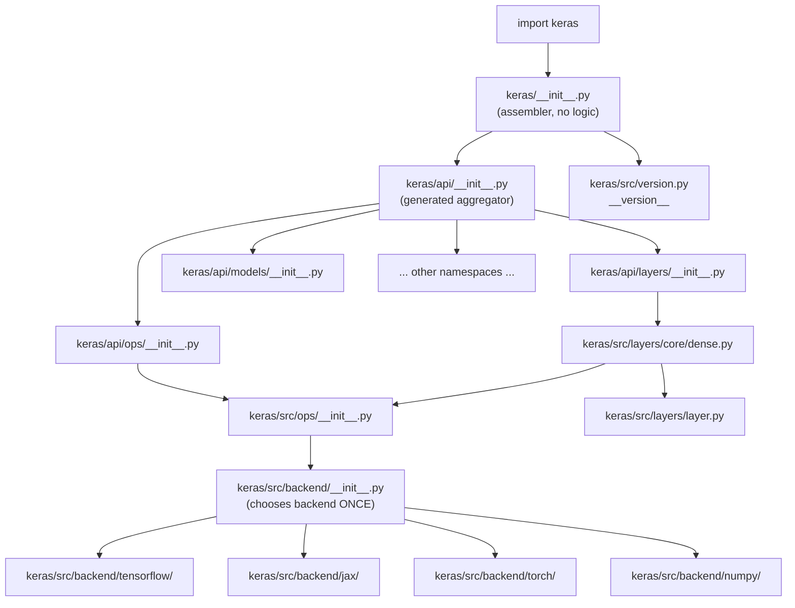

# Chapter 2 — Public API and Package Initialization

**Source-access reminder.** I still don't have live access to `~/projects/keras` or to GitHub. Everything below that is specific to file contents is marked *expected — verify*, with a command that confirms it in your clone. If your `git rev-parse` output or a `less` disagrees with anything here, paste it back and I'll correct the chapter in place. Chapter 1's conclusion still holds: public names live in `keras/api/`, implementations live in `keras/src/`, and the backend is chosen once at import.

## A. Chapter Objectives

By the end of this chapter you will be able to:

1. Explain exactly what executes when you type `import keras` — the full `__init__` chain, in order.
2. Distinguish the *generated* public API tree (`keras/api/`) from the *hand-written* package root (`keras/__init__.py`), and know what each contributes.
3. Locate and read `keras.src.version`, the single source of truth for `keras.__version__`.
4. Explain how `KERAS_BACKEND` and `~/.keras/keras.json` interact to select a backend at import time, and where that decision is implemented.
5. Explain the `tf.keras` shim: how `import tensorflow as tf; tf.keras.layers.Dense` ends up as the same class as `keras.layers.Dense`.
6. Regenerate the public API after a code change, using the repo's own tooling — the first skill you need for Chapter 28.

## B. Where This Fits in Keras

Chapter 1 established the map. Chapter 2 zooms into the two files at the very top of that map: `keras/__init__.py` and `keras/api/__init__.py`. Every subsequent chapter — reading `Layer`, tracing `fit()`, adding a new layer — starts with "open the file that defines this symbol." That file is almost always under `keras/src/`, and the way you *find* it from a public name is by reading `keras/api/`. So this chapter is the practical drill for the seam Chapter 1 described.

It also matters because **the API tree is machine-generated**. If you don't know that, you will eventually edit a file under `keras/api/`, watch your change survive `pytest`, and then watch it disappear the next time someone regenerates the API. This chapter inoculates you against that.

## C. Actual Source Files

**Expected layout — verify each of these with `ls`.**

| Path | Responsibility | Type |
|---|---|---|
| `keras/__init__.py` | Package root. Small. Pulls the public surface into the `keras` namespace. | hand-written |
| `keras/api/__init__.py` | Aggregates the public submodules (`layers`, `models`, `ops`, …) and re-exports `__version__`. | generated |
| `keras/api/<ns>/__init__.py` | One file per public namespace (`layers`, `models`, `optimizers`, …). Each line is a `from keras.src.X import Y`. | generated |
| `keras/api/_tf_keras/` | Public API tree used when TF imports `tf.keras`. | generated |
| `keras/_tf_keras/keras/__init__.py` | The importable module behind `tensorflow.keras`. | hand-written |
| `keras/src/version.py` | Defines `__version__`. The only place the version string lives. | hand-written |
| `keras/src/backend/__init__.py` | Chooses the backend and re-exports backend symbols into `keras.src.backend`. | hand-written |
| `keras/src/backend/config.py` | Resolves the backend name from env var + `~/.keras/keras.json`. | hand-written |
| `api_gen.py` (repo root) | The generator that *writes* `keras/api/`. | hand-written |
| `shell/api_gen.sh` | Wrapper that runs `api_gen.py` with the right environment. | hand-written |
| `pyproject.toml` | Declares packages, dependencies, optional-dependency groups (`tensorflow`, `jax`, `torch`), and the `tf_keras` extras. | hand-written |
| `setup.py` (if present) | Legacy packaging shim. | hand-written |

**Verify:**

```bash
cd ~/projects/keras
ls keras/__init__.py keras/api/__init__.py keras/src/version.py api_gen.py shell/api_gen.sh 2>&1
ls keras/api
ls keras/api/_tf_keras 2>/dev/null
ls keras/_tf_keras 2>/dev/null
```

If `keras/api/` and `api_gen.py` both exist, you're on Keras 3 and the generated-API story applies. If they don't, you're on Keras 2.x, and this chapter's "generated" language should be replaced by "hand-maintained" — tell me and I'll re-issue the chapter for your tree.

## D. Read the Code in the Correct Order

Follow this exact order. Do not skip step 3 — it's the one that changes how you think about everything downstream.

**1. The version file.**

```bash
less keras/src/version.py
```

**Expected — verify:** A one-line module: `__version__ = "3.x.y"`. That string is the *only* place the version is defined. `keras.__version__` and `pip show keras` both eventually read it. If you bump the version in a PR, this is the file you touch.

**2. The package root.**

```bash
less keras/__init__.py
wc -l keras/__init__.py
```

**Expected — verify:** Short (roughly under 30 lines in Keras 3). Its content is something in the shape of:

```python
from keras import api as _api
from keras.api import *  # noqa
from keras.src.version import __version__
```

Exact form varies by revision. The invariant to verify: **there are no `class` or `def` statements in this file that define user-facing behavior**. If you see one, note it — it's either a legacy shim or a revision-specific shortcut — and tell me.

**3. The generated API root.**

```bash
less keras/api/__init__.py
wc -l keras/api/__init__.py
```

**Expected — verify:** This is the file that does the heavy lifting. It will contain a long list of `from keras.api import <ns>` lines (one per public namespace) plus `from keras.src.version import __version__`. If your file has a header comment saying it's generated, read it — it will name the generator script.

The check that matters:

```bash
grep -n "DO NOT EDIT\|generated\|api_gen" keras/api/__init__.py keras/api/layers/__init__.py 2>/dev/null | head
```

A "do not edit" style header confirms the tree is generated. In that case, **never** edit files under `keras/api/` by hand except as a temporary local experiment — the correct edit is always in `keras/src/` followed by a regeneration (step 6).

**4. One generated namespace file, read carefully.**

```bash
less keras/api/layers/__init__.py
```

**Expected — verify:** A flat list of re-exports. This is the *inventory* of `keras.layers`: every public layer name is here. Read it end to end once. You'll notice:

- Symbols that come from `keras.src.layers.*` — the ones you'll read in later chapters.
- Symbols that come from `keras.src.legacy.*` or similar — compat shims.
- Possibly deprecated aliases with a comment.

**5. The backend-selection config.**

```bash
less keras/src/backend/config.py
```

**Expected — verify:** A function that resolves the backend name, in this order (typical):

1. The `KERAS_BACKEND` environment variable, if set.
2. The `"backend"` key in `~/.keras/keras.json` (path controlled by `KERAS_HOME`).
3. A default (typically `"tensorflow"`).

**Verify the resolution at runtime:**

```bash
python - <<'PY'
import os
print("KERAS_BACKEND env:", os.environ.get("KERAS_BACKEND"))
try:
    from keras.src.backend import config
    print("resolved backend:", config.backend())
except Exception as e:
    print("could not import keras:", e)
PY

# and the config file itself, if it exists
cat ~/.keras/keras.json 2>/dev/null || echo "no keras.json"
```

**6. The generator (skim, don't study yet).**

```bash
less shell/api_gen.sh
head -60 api_gen.py
```

**Expected — verify:** `shell/api_gen.sh` runs `api_gen.py` in a way that imports Keras and dumps the public surface. Don't try to fully understand the generator now; Chapter 28 will return to it. For this chapter the takeaway is: **`keras/api/` is derived from `keras/src/`, not the other way around.**

**7. The `tf.keras` shim.**

```bash
ls keras/_tf_keras
less keras/_tf_keras/keras/__init__.py 2>/dev/null
```

**Expected — verify:** The shim module's job is to make `import tensorflow as tf; tf.keras` resolve to the Keras 3 public surface. In Keras 3, this is achieved by TensorFlow's own lazy loader pointing `tf.keras` at the `keras._tf_keras.keras` module — which itself re-exports from `keras.api`. The runtime check:

```bash
python - <<'PY'
import keras
try:
    import tensorflow as tf
    print("tf.keras.layers.Dense is keras.layers.Dense:",
          tf.keras.layers.Dense is keras.layers.Dense)
except ImportError:
    print("tensorflow not installed in this env — skipping tf.keras check")
PY
```

This should print `True`. If it prints `False` or raises, you have a version skew between TF and Keras — worth noting but not blocking for this course.

## E. Explain the Implementation

**Concept 1 — three layers of initialization.**

`import keras` triggers three conceptually distinct phases, in order:

1. **Package root** (`keras/__init__.py`): assembles the namespace. No logic.
2. **API tree** (`keras/api/__init__.py` and its submodules): binds every public name to its implementation symbol. Mechanical, generated, no logic.
3. **Implementation tree** (`keras/src/*`): executes real code — backend selection, class definitions, registration. This is where side effects happen.

The design intent: keep phases 1 and 2 near-zero-cost and deterministic, so that all the interesting variability (which backend, which framework is installed) lives in phase 3, behind the backend seam.

**Concept 2 — the version string has exactly one home.**

`keras/src/version.py` defines `__version__`. Both `keras/__init__.py` and `keras/api/__init__.py` import it. `pyproject.toml` may or may not read it — **verify**:

```bash
grep -n "version" pyproject.toml | head
```

If `pyproject.toml` hard-codes a version string, you have *two* sources of truth and the release process has to keep them in sync. If it reads `keras/src/version.py` dynamically, there's one. Either way, the runtime truth is always `keras.src.version.__version__`.

**Concept 3 — the API tree is a projection, not a wrapper.**

Every line in `keras/api/*/__init__.py` is `from keras.src.<path> import <Name>`. That is a **name binding**, not a wrapper. Consequences:

- `keras.layers.Dense is keras.src.layers.core.dense.Dense` → `True`.
- Monkey-patching `keras.layers.Dense` does **not** affect `keras.src.layers.core.dense.Dense` (they're two names for the same object; you'd have to rebind the attribute in each module separately).
- Subclassing `keras.layers.Dense` gives you a class whose `__module__` still reports `keras.src.layers.core.dense`, unless you override it. This is why tracebacks from user code often point into `keras/src/...` even when the user only ever wrote `keras.layers.Dense`.

**Concept 4 — the generator is the reason the seam holds.**

The API tree is regenerated from the implementation tree. If you add a new class to `keras/src/layers/` and run the generator, the class appears in `keras/api/layers/__init__.py` automatically. If you *forget* to run the generator, the class exists but isn't public — `import keras; keras.layers.MyLayer` raises `AttributeError`. Chapter 28 will make this a full exercise.

*Python mechanics worth naming.*

- **`from X import *` with `__all__`.** `keras/__init__.py` may use this to pull in the public surface. When a module defines `__all__`, `import *` copies exactly that list. The generated `keras/api/__init__.py` typically defines `__all__` to keep the surface stable.
- **Module-level `__getattr__` (PEP 562).** Modern Keras uses module-level `__getattr__` in a few places to lazy-load optional dependencies (e.g., TensorFlow-only or JAX-only symbols). If you see `def __getattr__(name):` in a package `__init__.py`, that's why — the symbol only imports when first accessed.
- **Import side effects.** `keras/src/backend/__init__.py` *does* have a side effect: it selects a backend at first import. After that, the choice is frozen. This is not a bug; it's the mechanism.
- **`sys.modules` and re-import.** Because `keras/api/...` and `keras/src/...` are distinct module objects, `import keras.api.layers` and `import keras.src.layers` both execute and both appear in `sys.modules`. You can inspect:

  ```bash
  python -c "import keras, sys; print([m for m in sys.modules if m.startswith('keras') and 'src.layers.core' in m][:5])"
  ```

## F. Execution Flow

The exact chain for `import keras` in a typical Keras 3 revision:

```
1. Python finds keras/__init__.py and starts executing it.
2. keras/__init__.py imports keras.api  (or from keras.api import *)
3.   keras/api/__init__.py imports every public namespace
4.     keras/api/layers/__init__.py does
5.       from keras.src.layers.core.dense import Dense
6.         keras/src/layers/core/dense.py executes:
7.           imports keras.src.layers.layer
8.           imports keras.src.ops
9.             keras/src/ops/__init__.py imports keras.src.backend
10.              keras/src/backend/__init__.py reads config, chooses backend
11.                imports keras/src/backend/<chosen>/...
12.              backend symbols bound into keras.src.backend
13.           keras.src.ops symbols bound
14.         Dense class defined
15.     Dense bound into keras.api.layers
16.   ... other namespaces ...
17. keras/api/__init__.py imports keras.src.version and binds __version__
18. keras/__init__.py binds __version__ and finishes
19. import keras returns the keras module object
```

Mermaid — the two top-of-tree files and their roles:



Two points to internalize, in addition to Chapter 1's:

1. **`keras/api/*` runs before any layer class body executes.** The import order is: public namespaces → individual implementation modules → backend. So by the time `Dense.__init__` is defined, the backend is already chosen.
2. **The version is bound last, at the package root.** `keras.__version__` is available after `import keras` completes, but not *during* the import of `keras.api`.

## G. Practical Exploration

Each command is a small, safe inspection — nothing writes to your tree.

```bash
cd ~/projects/keras

# 1. Size and content of the two top files
wc -l keras/__init__.py keras/api/__init__.py
less keras/__init__.py
head -30 keras/api/__init__.py

# 2. Is keras/api generated?
grep -n "DO NOT EDIT\|generated\|api_gen" keras/api/__init__.py 2>/dev/null | head

# 3. Version: one source of truth, or two?
grep -n "__version__" keras/src/version.py keras/__init__.py keras/api/__init__.py 2>/dev/null
grep -n "version" pyproject.toml | head

# 4. Backend resolution, static and dynamic
less keras/src/backend/config.py
python - <<'PY'
from keras.src.backend import config
print("resolved backend:", config.backend())
PY
cat ~/.keras/keras.json 2>/dev/null || echo "no keras.json"

# 5. tf.keras identity check (only if TF is installed)
python - <<'PY'
import keras
try:
    import tensorflow as tf
    print("tf.keras.layers.Dense is keras.layers.Dense:",
          tf.keras.layers.Dense is keras.layers.Dense)
except ImportError:
    print("tensorflow not installed — skipping")
PY

# 6. Every public namespace Keras exposes
ls keras/api
```

**Interpretation guide:**

- Command 3: if `pyproject.toml` hard-codes a version string different from `keras/src/version.py`, note it — that's a known drift risk in some revisions.
- Command 4: the resolved backend should match `KERAS_BACKEND` if set, otherwise `keras.json`, otherwise the default.
- Command 5: `True` is the expected answer. `False` means TF has its own copy of Keras.
- Command 6: this is the *complete* list of public namespaces. Every chapter from 3 onward will address one of these.

## H. Hands-on Exercise

**Task: prove the API tree is generated, not hand-written.**

1. Back up `keras/api/layers/__init__.py`:

   ```bash
   cd ~/projects/keras
   cp keras/api/layers/__init__.py /tmp/layers_init_backup.py
   ```

2. Make a harmless, visible change to the *generated* file — add a comment at the top:

   ```bash
   sed -i '1i # LOCAL EXPERIMENT — this line will not survive regeneration' keras/api/layers/__init__.py
   head -3 keras/api/layers/__init__.py
   ```

3. Confirm it has no effect on the runtime surface (it's a comment, so nothing changes), then run the generator:

   ```bash
   bash shell/api_gen.sh
   head -3 keras/api/layers/__init__.py
   ```

   If the generator requires an environment (e.g., `tensorflow` present) that you don't have, run it with whatever backend is installed, or skip step 3 and just inspect `api_gen.py` to see how it writes the file.

4. Observe: the comment is gone. That's the proof.

5. Restore, just to be safe, even if the generator already overwrote it:

   ```bash
   git checkout -- keras/api/layers/__init__.py
   # or, if the file was untracked/experimental:
   # cp /tmp/layers_init_backup.py keras/api/layers/__init__.py
   ```

6. Then, as the real exercise, answer: **if you added a new class `Foo` to `keras/src/layers/core/foo.py`, what are the exact three things you would need to change or run to make `keras.layers.Foo` work?** Write down your answer; compare against Chapter 28 when we get there.

**Undo:** `git checkout -- keras/api/layers/__init__.py`. Nothing else was modified.

## I. Common Misunderstandings

- **"I should edit `keras/api/` to add a public name."** No. Edit `keras/src/`, then regenerate. Hand edits vanish on the next run.
- **"`keras.__version__` and `pip show keras` report the same thing."** They *usually* do, but only if `pyproject.toml` reads `keras/src/version.py` dynamically. If it hard-codes a version, they can diverge between releases. Verify in your revision.
- **"The API tree adds a function-call hop at runtime."** It does not. `keras.layers.Dense is keras.src.layers.core.dense.Dense` — one object, two names. There is no wrapper, no proxy, no dispatch.
- **"`KERAS_BACKEND` is consulted on every operation."** It's consulted once, when `keras.src.backend` is first imported. Changing the env var mid-process has no effect.
- **"`tf.keras` is a separate fork of Keras."** In Keras 3, it's the same objects reached through `keras._tf_keras`. `tf.keras.layers.Dense is keras.layers.Dense` should be `True`.
- **"The generator is only for maintainers."** It's also for you, the moment you add a public symbol. Chapter 28 turns this into a full exercise.
- **"`keras/api/__init__.py` runs after `keras/src/`."** It runs *as* `keras/src/` is imported, in a specific order: namespaces first, implementations next, backend chosen when the first implementation module imports `keras.src.ops`. Re-read section F if this ordering feels unintuitive.

## J. Chapter Summary

- `import keras` executes three distinct phases: assembler (`keras/__init__.py`) → generated API tree (`keras/api/`) → implementation + backend selection (`keras/src/`).
- `keras/api/` is **generated** from `keras/src/`; the generator is `api_gen.py` driven by `shell/api_gen.sh`.
- `keras.__version__` traces back to a single file, `keras/src/version.py`, though `pyproject.toml` may or may not duplicate it.
- The backend is selected once, during the first import of `keras.src.backend`, by reading `KERAS_BACKEND` and/or `~/.keras/keras.json`.
- `tf.keras` and `keras` share the same class objects through `keras._tf_keras`.
- Re-exports are name bindings, not wrappers — there is no runtime cost, and identity checks (`is`) confirm it.

## K. Knowledge Check

Answer any subset; I'll grade before moving on if you like, or you can take **Next Chapter** and answer later.

1. *(Recall)* What are the three initialization phases of `import keras`, and what does each contribute?

2. *(Code reading)* You see `from keras.src.layers.core.dense import Dense` in `keras/api/layers/__init__.py`. Without running Python, how would you check whether the same line also appears in `keras/_tf_keras`? What would it mean if it did, and what if it didn't?

3. *(Reasoning)* Why does the generator, rather than hand maintenance, make sense for `keras/api/`? Name at least one cost of the generator approach.

4. *(Design)* The backend is chosen at import time. Where exactly in the chain in section F does this happen, and what does that imply about `import keras` when the chosen backend is not installed?

5. *(Navigation)* Write the `git grep` command to find every place in the repo that writes to `keras/api/` — i.e., every place that could, if run, overwrite a hand edit. (Hint: think about the generator's output paths.)


---
