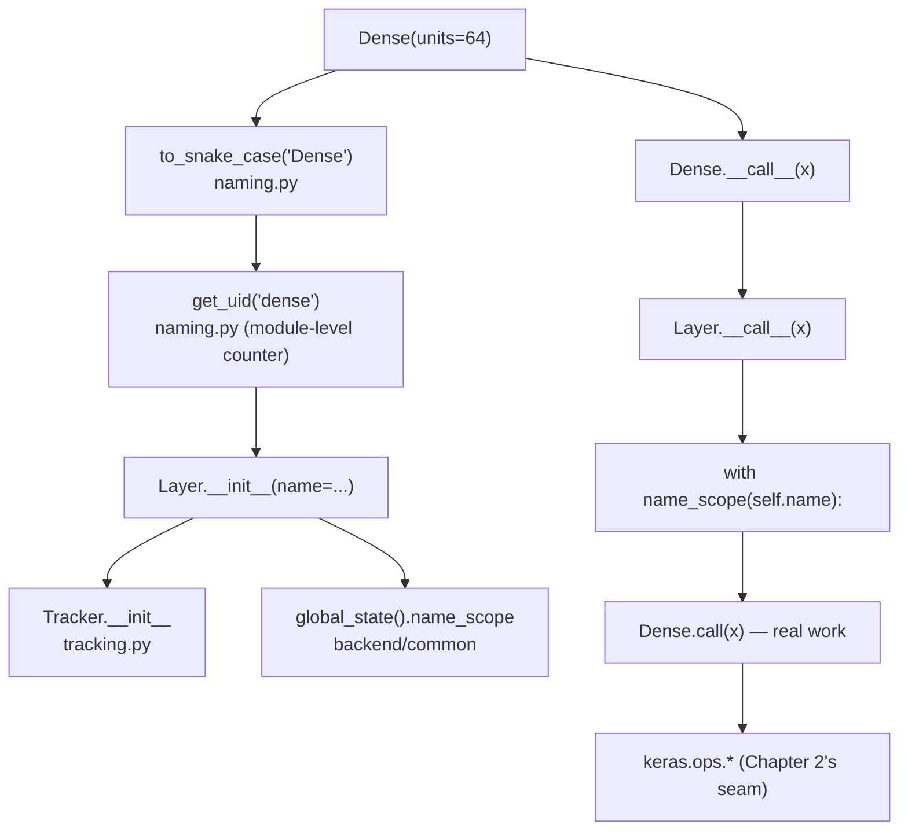

# Chapter 3 — Utilities, Naming Conventions, and Internal Infrastructure

**Source-access reminder.** Still no live access to `~/projects/keras` or GitHub. Every file-level claim below is marked *expected — verify* with a command that confirms it in your clone. If a path or class name disagrees with your tree, paste the `ls`/`git grep` output and I'll correct the chapter in place. The Step 0 commands from Chapter 1 (`git rev-parse --short HEAD`, `python -c "import keras; print(keras.__version__)"`) are still the fastest way to stop hedging.

## A. Chapter Objectives

By the end of this chapter you will be able to:

1. Describe what lives in `keras/src/utils/` and why it is the first place to look when a helper is missing elsewhere.
2. Explain the **global naming system** (`get_uid`, `to_snake_case`, `unique_object_name`) and how layer/model names get generated.
3. Explain **`global_state()`** — the process-wide singleton that tracks the current `name_scope`, `EagerTensor`/`KerasTensor` context, and other cross-cutting state.
4. Explain the **`Tracker`** class in `keras/src/utils/tracking.py` and what it means for a Keras object to *own* a variable or sublayer.
5. Recognize `@keras_export`, `LazyModule`, and other internal-infrastructure idioms when you see them in `keras/src/`.
6. Navigate the repo using `git grep` to find where a `get_uid`-style utility is defined, used, and tested.

You will not yet study `Layer` or `Variable` bodies — those are Chapters 4 and 5. This chapter is the toolbox that the rest of the library is built with.

## B. Where This Fits in Keras

Every subsequent chapter will lean on this one. `Layer.__init__` calls `get_uid`; `Model` uses `Tracker` to own its layers; `Functional` uses `global_state` to distinguish symbolic from eager execution; every public symbol in the API tree is annotated with `@keras_export`. If you don't recognize these primitives, you will read code like this:

```python
@keras_export("keras.layers.Dense")
class Dense(Layer):
    def __init__(self, units, ...):
        self._name = backend.get_uid("dense")
        ...
```

and not know what half the tokens mean. Chapter 3 makes them all legible.

The utilities chapter also has a pragmatic role: **when you can't find where something is defined, look in `keras/src/utils/` first.** It's the junk drawer, but it's a disciplined junk drawer — everything in it is generic, framework-agnostic, and used by multiple subsystems.

## C. Actual Source Files

**Expected layout — verify each of these with `ls` or `git ls-files`.**

| Path | Responsibility |
|---|---|
| `keras/src/utils/__init__.py` | Convenience re-exports of the most-used utilities. |
| `keras/src/utils/naming.py` | `get_uid`, `to_snake_case`, `to_camel_case`, `unique_object_name`. The Keras naming system. |
| `keras/src/utils/tracking.py` | `Tracker` — attribute-tracking base class used by `Layer` and `Model`. |
| `keras/src/utils/python_utils.py` | Generic Python helpers: `to_list`, `is_default`, `default`, `unpack_singleton`, `is_none_or_empty`. |
| `keras/src/utils/file_utils.py` | Path resolution, downloading, caching (`get_file`, `resolve_path`). Used by `applications/` and `datasets/`. |
| `keras/src/utils/module_utils.py` | `LazyModule` — deferred module import for optional dependencies. |
| `keras/src/utils/traceback_utils.py` | Traceback filtering (`filter_traceback`, `format_error`). |
| `keras/src/utils/jax_layer.py` / `jax_utils.py` (backend-specific) | JAX-only utilities. |
| `keras/src/utils/argument_validation.py` | `assert_same_type`, `standardize_*` helpers used in layer `call()` methods. |
| `keras/src/utils/dtype_utils.py` | DTYPE resolution helpers. |
| `keras/src/utils/io_utils.py` | Reading/writing `.keras` archive members (JSON, weights). |
| `keras/src/utils/progbar.py` | The progress bar used by `fit`/`evaluate`. |
| `keras/src/utils/summary_utils.py` | Model summary rendering. |
| `keras/src/utils/timeseries_dataset_utils.py` | Helpers for `timeseries_dataset_from_array`. |
| `keras/src/utils/image_dataset_utils.py` | Helpers for `image_dataset_from_directory`. |
| `keras/src/utils/text_dataset_utils.py` | Helpers for `text_dataset_from_directory`. |
| `keras/src/utils/code_stats.py` | Small helpers used by tooling. |
| `keras/src/utils/backend_utils.py` | Thin helpers on top of the backend module. |
| `keras/src/backend/common/global_state.py` | The `global_state()` singleton. |
| `keras/src/backend/common/keras_tensor.py` | `KerasTensor` — the symbolic tensor (Chapter 9). |
| `keras/src/backend/common/variables.py` | `KerasVariable` — the variable wrapper (Chapter 5). |
| `keras/src/backend/common/stateless_scope.py` | Context manager that makes variable writes throwaway (used by JAX). |
| `keras/src/backend/common/name_scope.py` | The `name_scope` context manager. |
| `namex/` (external PyPI package `namex`) | The `@keras_export` decorator and namespace-scanning machinery. Keras lists it as a dependency in `pyproject.toml`. |

**Verify:**

```bash
cd ~/projects/keras
ls keras/src/utils
ls keras/src/backend/common
grep -n "namex" pyproject.toml requirements*.txt 2>/dev/null
python -c "import namex; print(namex.__version__)" 2>/dev/null || echo "namex not importable"
```

If `namex` is not a separate package in your revision (some early Keras 3 alphas vendored it under `keras/src/namex/`), note that — the `@keras_export` decorator then lives inside the repo, and `git grep keras_export` will show both definition and usage.

## D. Read the Code in the Correct Order

**1. Naming.**

```bash
less keras/src/utils/naming.py
```

**Expected — verify:** You should see at least these:

- `get_uid(prefix="")` — returns a new unique string like `dense_1`, `dense_2`, … using a process-wide counter keyed by prefix.
- `to_snake_case(name)` — `"DenseLayer"` → `"dense_layer"`. Used to derive a default layer name from its class name.
- `to_camel_case(name)` — the reverse. Used by the API generator.
- `unique_object_name(name, ...)` — deduplicates a name against a set of already-used names by appending `_1`, `_2`, …

The exact function signatures vary slightly by revision; the concept does not.

**Verify at runtime:**

```bash
python - <<'PY'
from keras.src.utils import naming
print(naming.to_snake_case("DenseLayer"))
print(naming.to_camel_case("dense_layer"))
print(naming.get_uid("dense"))
print(naming.get_uid("dense"))
print(naming.get_uid("dense"))
PY
```

Expect `dense_layer`, `DenseLayer`, and three consecutive integers. The counter is **process-wide and monotonic** — re-running the process resets it.

**2. The naming / state singleton.**

```bash
less keras/src/backend/common/global_state.py
less keras/src/backend/common/name_scope.py
```

**Expected — verify:** A module-level `GLOBAL_STATE` dict/object plus a `global_state()` accessor. `name_scope` is a context manager that pushes/pops a prefix used by `get_uid` and by `KerasTensor`'s string representation. Everything that needs "the current name scope" or "the current function-scope depth" reads this singleton.

**Concept worth naming now:** Keras uses module-level globals on purpose — they're not accidental. The alternative (thread-local or context-var state) was considered and rejected for backend simplicity. This has a real consequence: **Keras's naming is not thread-safe in the sense that two threads constructing layers concurrently will interleave their UID counters.** In practice this hasn't bitten most users, but it's a legitimate constraint to know.

**3. Tracking.**

```bash
less keras/src/utils/tracking.py
```

**Expected — verify:** A `Tracker` class and a `trackable` decorator-ish behavior. Key methods typically:

- `Tracker.track(value)` — record a value.
- `Tracker.lock()` / `unlock()` — freeze the tracked set.
- `Tracker.stored_items()` — iterate over tracked items.
- Hooks like `_track_value` / `_track_variables` / `_track_layers` (names vary by revision).

`Layer` and `Model` subclass or compose `Tracker`. Chapter 4 will show you the composition; here just note the contract: **when you assign `self.w = self.add_weight(...)` inside a layer, `Tracker` is what makes `self.w` discoverable as a variable.** This is the mechanism behind `.weights`, `.trainable_weights`, `.variables` on a Keras layer.

**4. Python helpers.**

```bash
less keras/src/utils/python_utils.py
```

**Expected — verify:** Small, boring, used everywhere:

- `to_list(x)` — `None → []`, scalar → `[scalar]`, iterable → `list(iterable)`.
- `default(x, value)` / `is_default(x, value)` — the Keras convention for "user didn't pass this" sentinel handling.
- `unpack_singleton(x)` — `[x] → x`, `x → x`.
- `is_none_or_empty(x)`.
- `ObjectIdentityDict` in some revisions.

These are the vocabulary of Keras's argument-handling style. Chapter 4's `Layer.__init__` reads much more easily once you know them.

**5. Lazy modules.**

```bash
less keras/src/utils/module_utils.py
```

**Expected — verify:** A `LazyModule` class whose `__getattr__` imports and returns a submodule on demand. Used to avoid importing e.g. TensorFlow until the user touches something TF-specific. Contrast with the PEP 562 module-level `__getattr__` you may have seen in Chapter 2.

**6. The `@keras_export` decorator (source of public API).**

```bash
python -c "import namex, inspect; print(inspect.getsourcefile(namex))"
# then less that file
```

If `namex` is a separate package, `@keras_export("keras.layers.Dense")` is defined there, and its job is to *annotate* classes and functions with their public path. The API generator (`api_gen.py`, Chapter 2) walks `keras/src/`, collects these annotations, and writes the re-export tree.

**Verify the annotation on a real class:**

```bash
git grep -n "@keras_export" -- keras/src/layers/core/dense.py | head
git grep -n "@keras_export" -- keras/src | wc -l
```

The count gives you the *size* of the public surface as declared. It should roughly match the number of symbols in `keras/api/*/__init__.py`.

**7. A small stylistic check on the utilities package as a whole.**

```bash
wc -l keras/src/utils/*.py | sort -n | tail -20
```

This tells you which utilities are "large enough to matter." Expect `tracking.py`, `naming.py`, `python_utils.py`, and `io_utils.py` near the top.

## E. Explain the Implementation

**Concept 1 — `get_uid` and the naming contract.**

Layer and model names are user-visible: they show up in `model.summary()`, in saved files, and in error messages. Keras derives a default name by:

1. `to_snake_case(ClassName)` — `Dense` → `"dense"`.
2. `get_uid(prefix)` — append a process-global counter.

So the first three `Dense` layers you build in a fresh process are `dense`, `dense_1`, `dense_2`. If you pass `name="my_dense"`, the prefix changes and the counter is keyed by `"my_dense"`. This is why two layers with the same explicit name raise an error inside a model: `unique_object_name` is what enforces uniqueness within a container.

The counter is **process-wide and resets on restart**. Reproducibility of layer names across runs is therefore only guaranteed for layers with explicit names, or for layers constructed in the same order in both runs.

**Concept 2 — `global_state` is the escape hatch for cross-cutting state.**

`name_scope` is a good example. `Layer.__call__` (Chapter 4) enters a name scope derived from the layer's name; inside, any `get_uid` prefix and any `KerasTensor.name` includes the scope. That state has to live somewhere accessible from arbitrary code, so Keras uses a module-level singleton rather than threading it through every function signature.

Consequences:

- **It's cheap.** No thread-locals, no `contextvars`, no dependency injection.
- **It's process-global.** Concurrent construction of layers in two threads interleaves their UID counters and their name scopes.
- **It's a leak-magnet.** If a function enters a scope and raises without exiting, the scope persists. Keras uses `contextlib.contextmanager` and `try/finally` everywhere for this reason — but it's worth being alert to.

**Concept 3 — `Tracker` is Python-level ownership, not GC.**

`Tracker` records "this object owns that value." For `Layer`/`Model`, the tracked values are variables, sublayers, and metric objects. It is *not* a Python garbage-collector and *not* a memory manager. Its purpose is enumerability: `layer.weights` walks the tracker; `model.save()` walks the tracker to find what to serialize.

Design trade-off: tracking is by identity, so re-assigning `self.w = new_variable` after `lock()` may or may not update the tracker depending on revision. This is why Keras layers are meant to be **built once** — assignment after `build()` is discouraged for exactly this reason.

**Concept 4 — `@keras_export` is metadata, not dispatch.**

Decorating `Dense` with `@keras_export("keras.layers.Dense")` does **nothing at import time** beyond attaching an attribute (something like `__keras_export__`) to the class. The API generator reads that attribute later. If you remove the decorator and forget to regenerate, `keras.layers.Dense` still works because `keras/api/layers/__init__.py` still has the re-export line. But if you regenerate, the symbol disappears. So the decorator is the *declaration*; the API tree is the *implementation* of the declaration.

**Concept 5 — `python_utils` encodes Keras's argument style.**

Two conventions are worth naming:

- **Sentinel defaults.** Many Keras APIs use `x=None` and distinguish "user passed None" from "user passed nothing" via an internal sentinel (`"default"` string, or a module-private class). `python_utils` has helpers for this.
- **`to_list` normalization.** Keras APIs accept scalars, tuples, and lists interchangeably (e.g., `strides=2` vs `strides=(2, 2)`). `to_list` is the canonical normalizer.

Chapter 4 will show how `Layer.__init__` uses these to accept flexible arguments.

*Python mechanics worth naming.*

- **Module-level mutable state.** `_UID_PREFIXES = {}` in `naming.py` is a module-level dict. It persists for the process lifetime. This is why `get_uid` "remembers" across calls.
- **Decorator metadata.** `@keras_export("path")` attaches `f.__keras_export__ = "path"`. Anyone (including you) can read this at runtime:
  ```bash
  python -c "from keras.layers import Dense; print(getattr(Dense, '__keras_export__', None))"
  ```
- **`contextmanager`.** Both `name_scope` and `stateless_scope` are implemented with `@contextlib.contextmanager`, which is the Pythonic way to write a resource-scoped block. Read the `try/finally` inside each if you want to see the state-restoration guarantee.
- **`__getattr__` on a module.** `LazyModule` uses this to defer imports. This is the mechanism that lets `import keras` succeed when only one of `tensorflow`/`jax`/`torch` is installed.

## F. Execution Flow

Where these primitives show up on the path from `Dense(units=64)` to a named layer:

```
Dense.__init__(units=64, name=None, ...)
  └─ name = name or to_snake_case("Dense")        # naming.py
  └─ self._name = get_uid(name)                   # naming.py
  └─ super().__init__(name=self._name, ...)       # Layer.__init__
        └─ Tracker.__init__()                     # tracking.py
        └─ self._tracker.lock()                   # freeze tracked set
        └─ self._name_scope = name_scope(...)     # global_state
  └─ self.units = units
  └─ ... further setup, then build() on first call
```

And for a forward call, `Dense.__call__`:

```
Dense.__call__(x)
  └─ Layer.__call__(x)
        └─ with name_scope(self.name):            # global_state
              return self.call(x)                 # the layer's real work
```

Mermaid — how the utilities interlock during construction and calling:



The two flows above are the ones you will see repeated in every layer chapter. Names come from `naming.py`; ownership comes from `tracking.py`; the current scope comes from `global_state`.

## G. Practical Exploration

All commands are read-only.

```bash
cd ~/projects/keras

# 1. Inventory the utilities
ls keras/src/utils
wc -l keras/src/utils/*.py | sort -n | tail -20

# 2. The naming system, source and runtime
less keras/src/utils/naming.py
python - <<'PY'
from keras.src.utils import naming
print("snake:", naming.to_snake_case("DenseLayer"))
print("camel:", naming.to_camel_case("dense_layer"))
print("uid:", naming.get_uid("dense"), naming.get_uid("dense"), naming.get_uid("dense"))
PY

# 3. Global state & name scope
less keras/src/backend/common/global_state.py
less keras/src/backend/common/name_scope.py

# 4. Tracking
less keras/src/utils/tracking.py
git grep -n "class Tracker" -- keras/src
git grep -n "Tracker" -- keras/src/layers/layer.py | head

# 5. @keras_export — the annotation that drives the public API
git grep -c "@keras_export" -- keras/src | sort -t: -k2 -rn | head
python -c "from keras.layers import Dense; print(getattr(Dense, '__keras_export__', None))"

# 6. Lazy modules
less keras/src/utils/module_utils.py
python - <<'PY'
from keras.src.utils.module_utils import LazyModule
# pick one that's optional in your env
import importlib
for name in ("tensorflow", "torch", "jax"):
    try:
        importlib.import_module(name)
        print(name, "installed")
    except ImportError:
        print(name, "NOT installed")
PY

# 7. Where the primitives are used
git grep -n "get_uid" -- keras/src | head -20
git grep -n "global_state" -- keras/src | head -20
```

**Interpretation guide:**

- Command 2: three consecutive integers (e.g., `dense`, `dense_1`, `dense_2`). If you get the same number three times, you're on an odd revision — tell me.
- Command 5: the list of files by `@keras_export` density is a good proxy for "public API surface area." The top of the list is where the public API is concentrated.
- Command 7: `get_uid` and `global_state` hits tell you which subsystems lean on the shared infrastructure. If a layer file calls `global_state` directly, that's a code smell — layers should go through `Layer.__call__`'s name scope. Note such cases and we'll look at them when we read that chapter.

## H. Hands-on Exercise

**Task: use the utilities directly to build a small naming experiment.**

Write a short script `~/tmp/naming_experiment.py` (outside the repo — don't modify Keras):

```python
from keras.src.utils import naming

print("-- raw counters --")
for _ in range(3):
    print(naming.get_uid("dense"))
for _ in range(3):
    print(naming.get_uid("conv"))

print("-- with a name scope --")
from keras.src.backend.common import name_scope
with name_scope("block1"):
    a = naming.get_uid("layer")
    b = naming.get_uid("layer")
print("inside block1:", a, b)
with name_scope("block2"):
    c = naming.get_uid("layer")
print("inside block2:", c)

print("-- snake/camel round-trip --")
for s in ("Dense", "Conv2D", "MultiHeadAttention", "LSTMCell"):
    print(s, "->", naming.to_snake_case(s), "->", naming.to_camel_case(naming.to_snake_case(s)))
```

Run it:

```bash
python ~/tmp/naming_experiment.py
```

Answer these:

1. What do you observe about `get_uid("dense")` vs `get_uid("conv")`? Are the counters independent or shared?
2. Does entering a new `name_scope` reset the counter? Why or why not? (Check `naming.py`.)
3. Does `to_camel_case(to_snake_case(x)) == x` hold for all four examples? If not, why not, and does that matter for Keras's use of these functions?
4. Is the naming state thread-safe? Sketch a two-thread test that would show interleaving, and predict what you'd see. (No need to run it.)

**Undo:** delete `~/tmp/naming_experiment.py`. Nothing inside the repo was touched.

## I. Common Misunderstandings

- **"`get_uid` gives a globally unique name forever."** It's process-local. Restart Python and the counter resets. Don't rely on it across processes for anything you care about; use explicit `name=` if you need stability.
- **"`global_state()` is per-thread or per-context."** It's a module-level singleton. Two threads share it. This is a deliberate, documented design choice, not an oversight.
- **"`@keras_export` makes a symbol public immediately."** It just annotates. The public API is realized in `keras/api/`, generated separately. Remove the decorator but forget to regenerate, and the symbol stays public.
- **"`Tracker` is Keras's memory manager."** No. It's an owner registry. Python's GC does memory; `Tracker` tells Keras what to serialize and enumerate.
- **"`LazyModule` is the same as a module-level `__getattr__`."** Both are lazy-loading idioms, but `LazyModule` is *object-level* (a proxy) and is used when a module needs to be substituted into another namespace; module-level `__getattr__` is *module-level* and is used for a few optional top-level symbols. Different mechanisms, different call sites.
- **"`python_utils` is a heap of unrelated helpers."** It's the vocabulary of Keras's argument conventions — `to_list`, `default`/`is_default`, `unpack_singleton`, `is_none_or_empty`. Reading `Layer.__init__` without knowing these is painful.
- **"Utilities are stable across versions."** They are among the *least* stable parts of `keras/src/`. Public API stability does not extend here. If you depend on them, pin your Keras version.
- **"I can edit `keras/src/utils/` freely."** You can read freely; contributions must follow Keras conventions (`CONTRIBUTING.md`, tests, `@keras_export` where applicable). The utilities are exactly where subtle bugs persist longest because they're used everywhere.

## J. Chapter Summary

- `keras/src/utils/` is the toolbox: naming, tracking, Python helpers, file I/O, module laziness, argument validation, progress bars, model summary, dataset helpers.
- **Naming:** `get_uid` (process-local monotonic counter), `to_snake_case`/`to_camel_case`, `unique_object_name`. Layer/model names derive from these.
- **State:** `global_state()` is a process-wide singleton used for `name_scope` and other cross-cutting state. Not thread-local. Deliberate.
- **Ownership:** `Tracker` records what a Keras object owns (variables, sublayers, metrics). Its job is enumeration and serialization, not memory management.
- **Public API annotation:** `@keras_export("keras...")` is metadata. `keras/api/` is the realization. They must be kept in sync by the generator.
- **Conventions:** `python_utils.py` encodes Keras's argument-handling idioms — `to_list`, `default`/`is_default`, `unpack_singleton`, `is_none_or_empty`.

You now recognize every primitive that `Layer`, `Model`, and `Trainer` will use. Chapter 4 is where these all appear together for the first time.

## K. Knowledge Check

Answer any subset; I'll grade before moving on if you like, or you can take **Next Chapter** and answer later.

1. *(Recall)* What does `get_uid("dense")` return on its first three calls in a fresh Python process, and where does the state that produces that answer live?

2. *(Code reading)* Given
   ```python
   class MyLayer(Layer):
       def __init__(self):
           self.w = self.add_weight(shape=(4,), name="w")
   ```
   which utility is responsible for making `self.w` appear in `MyLayer().weights`? Name the file and the class.

3. *(Reasoning)* Explain why `@keras_export("keras.layers.Dense")` alone is not sufficient to make `keras.layers.Dense` work. What else has to exist?

4. *(Design)* `global_state()` is a module-level singleton. Name one thing that design makes easy, and one thing it makes hard. Would thread-locals fix the hard thing without breaking the easy thing? Why or why not?

5. *(Navigation)* Write the `git grep` command that finds every use of `unique_object_name` in `keras/src/`, and from the results identify which subsystem owns uniqueness enforcement (layers? models? something else?).
